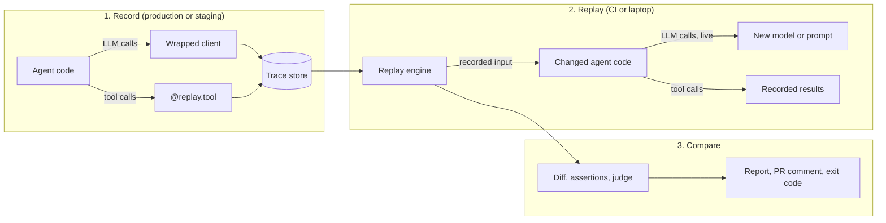

# Replay: design

*Status: draft for approval, 2026-09-25.*

Replay is regression testing for AI agents. It records real agent runs, then re-runs each recorded input against a changed agent (a new prompt, model or code). During the re-run, tool calls are answered from the recording so nothing real happens, and Replay reports which runs got worse. It runs in CI, so a change that breaks agent behavior fails the build before it reaches customers.

## 1. Problem

Teams building agents change them constantly. They rewrite prompts, swap models to cut cost, and add or edit tools. Any of these changes can quietly alter behavior. The agent calls the wrong tool, passes the wrong arguments, skips a verification step, answers worse, or costs more. Normal software has regression tests for this. Agents mostly don't, for three reasons:

- **Outputs are not exact.** Two good answers rarely match word for word, so ordinary equality checks fail.
- **Tools touch real systems.** Re-running an agent means re-sending emails, re-issuing refunds and re-hitting production APIs. Nobody wants that in CI.
- **Test cases are expensive to write.** Hand-written eval sets are small, go stale, and don't look like real traffic.

So teams find out from customers. Existing tools mostly offer dashboards, which show what happened, and hand-written evals, which check a curated set. Neither answers the question a developer has when opening a pull request: *if I ship this, which of last week's real conversations would go differently, and are they worse?*

Replay answers that question by turning real production runs into regression tests.

## 2. Users

**Primary: an engineer on a small AI product team** (2 to 20 engineers) building a tool-using agent in Python directly on the Anthropic or OpenAI SDK. They ship prompt, model and tool changes weekly or faster. They want a check that runs on every pull request, finishes in minutes, costs little, and points at the exact step that changed. They won't spend a week writing evals, and they won't accept a test that can refund a real customer.

**Secondary: the reviewer of that pull request.** They never run Replay themselves. They read a PR comment such as "48 runs replayed, 3 regressions, cost −41%" and open the HTML report to see what went wrong.

**Not targeted by the MVP:** researchers benchmarking models offline, teams not using Python, and agents built on frameworks Replay doesn't adapt to yet (see section 15).

## 3. How it works

Replay works in three phases.



1. **Record.** A few lines added to the agent capture every run: the input, each LLM call, each tool call and its result, and the final output. One run becomes one *trace*.
2. **Replay.** For each recorded trace, Replay calls the agent's entry point again with the same input, under the new configuration. LLM calls go to the real model, because the model's behavior is what's being tested. Tool calls are intercepted and answered from the recording. The agent sees the same data it saw originally, and nothing real happens.
3. **Compare.** Replay compares the new run with the original. It checks four things:
   - which tools were called, and with what arguments;
   - whether the user's rules still hold;
   - whether the final answer got better or worse, which an LLM judge decides;
   - how cost and latency changed.

   Each run is labeled *regression*, *improvement* or *equivalent*.

### Glossary

| Term | Meaning |
|---|---|
| Trace | Everything that happened in one agent run, in order. |
| Step | One LLM call or one tool call inside a trace. |
| Baseline | A recorded trace, used as the reference. |
| Candidate | The trace produced by replaying a baseline's input under the new configuration. |
| Session | One `replay run`: a set of baselines replayed under one configuration, plus the results. |
| Mock | A tool result served from the baseline instead of actually running the tool. |
| Read-only tool | A tool the user has declared safe to run for real during replay, such as a search. |
| Side-effect tool | Every other tool. It never runs during replay. |

## 4. Architecture

Replay is one Python package with clear internal boundaries. Each module can be understood and tested on its own.

| Module | Responsibility | Depends on |
|---|---|---|
| `replay.schema` | Pydantic models for traces, steps and sessions. The contract between all other modules. | pydantic |
| `replay.recorder` | Run context, `@replay.agent`, `@replay.tool`, `replay.wrap()`. Turns live activity into steps. | schema |
| `replay.recorder.adapters` | One adapter per API (Anthropic Messages, OpenAI Chat Completions, OpenAI Responses). Translates provider requests and responses into provider-neutral steps. | schema, provider SDK (optional) |
| `replay.store` | SQLite storage, JSON import and export, schema version checks. | schema |
| `replay.engine` | Loads the config and re-runs the entry point for each trace in parallel. Applies overrides, matches and mocks tool calls, enforces safety, and paces LLM calls. | recorder, store |
| `replay.compare` | Structural diff, assertions, LLM judge, cost and latency, each run's verdict, the session summary. | schema |
| `replay.report` | HTML report and Markdown PR summary (Jinja2). | compare |
| `replay.cli` | `init`, `run`, `report`, `export`, `import`, `list` (Typer). | all of the above |

Three principles run through the design:

- **Fail open when recording, fail closed when replaying.** In production, a bug in Replay must never break the agent. Recorder errors are logged and swallowed, and the agent runs as if Replay weren't there. During replay the opposite holds. If Replay is unsure whether a tool call is safe, it blocks it.
- **One trace format for recorded and replayed runs.** A replay produces an ordinary trace, so a comparison is always trace against trace. That keeps the diff code simple and lets a replayed run serve as a new baseline.
- **Provider details stay in adapters.** The engine, diff and report only see provider-neutral steps: model, requested tool calls, text and token usage. Supporting a new provider or framework means adding an adapter, not changing the core.

The dependencies are pydantic, typer, jinja2 and pyyaml. The `anthropic` and `openai` SDKs are optional extras, imported only when a client of that type is wrapped.

## 5. Recording

### 5.1 Adding Replay to an existing agent

```python
import replay                                   # 1
client = replay.wrap(OpenAI())                  # 2  also Anthropic(), AsyncOpenAI(), AsyncAnthropic()

@replay.agent                                   # 3  marks where one agent run starts and ends
def handle_ticket(message: str) -> str: ...

@replay.tool                                    # plus one decorator per tool
def lookup_order(order_id: str) -> dict: ...
```

That is three lines plus one decorator per tool.

- **`replay.wrap()`** returns a drop-in wrapper around the client. Its `create` methods are instrumented, everything else passes straight through, and type checkers still see the original client type.
- **Recording is on by default** and writes to `.replay/replay.db`.
- **Two environment variables control it:** `REPLAY_RECORD=0` turns recording off, and `REPLAY_SAMPLE_RATE=0.1` records one run in ten.

### 5.2 What is captured

- **Per run:** a run ID, timestamps, and the entry point's import path (`support_agent.agent:run`). Also its arguments (the input), its return value (the output) or exception, and user tags such as git SHA or prompt version.
- **Per LLM call:**
  - provider, API and model;
  - the full request (messages, system prompt, tools, parameters) and the full raw response;
  - normalized fields: the tool calls the model asked for, the text it returned, and the stop reason;
  - token usage (input, output, cached, reasoning), latency and any error.
- **Per tool call:** tool name, arguments, result or exception, and latency. Arguments are recorded by parameter name, so `lookup_order("A1")` and `lookup_order(order_id="A1")` record the same way.

**Supported client calls:**
- `messages.create` (Anthropic);
- `chat.completions.create` and `responses.create` (OpenAI).

Each works with both sync and async clients. OpenAI-compatible providers (Groq, Gemini, Together, local servers) use the OpenAI SDK with a different `base_url`, so they work with no extra code. Streaming is out of scope for the MVP.

### 5.3 Run context and concurrency

The current run is held in a Python `contextvar`, so concurrent runs are safe without any locking in user code. Each thread or asyncio task sees only its own run. Two edge cases:

- An LLM or tool call made outside any run is passed through untouched.
- A decorated agent called inside another run becomes part of the outer run instead of starting a new trace.

One known gap: the agent may start its own threads for tool calls, for example through its own `ThreadPoolExecutor`. Python does not copy the context into those threads. In record mode, calls made there are not recorded, and Replay logs a warning. In replay mode they are blocked, because replay fails closed.

### 5.4 Extension points

The recorder core only knows how to append provider-neutral steps to the current run. The SDK wrappers are one way to produce those steps. Two planned adapters fit the same shape without changing the core:

- **LangGraph:** a callback handler that turns LangChain LLM and tool events into steps.
- **OpenTelemetry:** an importer that converts spans using the GenAI semantic conventions into traces. Teams that already emit OpenTelemetry can then import runs without re-instrumenting.

### 5.5 Production safety and overhead

- **No I/O during the run.** A trace is buffered in memory and written in a single insert when the run ends.
- **Several processes can write.** SQLite runs in WAL mode.
- **Errors never escape.** Every recorder code path is wrapped, so an internal error is logged and ignored.
- **Unusual tool results are flagged early.** Tool results must be JSON values, Pydantic models or dataclasses. Anything else is stored as its `repr` and the step is marked not replayable at record time, so the problem surfaces early.

## 6. Trace schema

Traces are defined with Pydantic v2 and versioned with an integer `schema_version` (the MVP uses `1`).

```
Trace
  schema_version   int
  run_id           str (uuid)
  source           "record" | "replay"
  replay_of        run_id of the baseline (replays only)
  entrypoint       "package.module:function"
  input            {"args": [...], "kwargs": {...}}
  output           any JSON value, or null
  error            {type, message}, or null
  tags             {str: str}
  started_at, ended_at
  steps            ordered list of LLMStep | ToolStep

LLMStep  (kind = "llm")
  index, started_at, latency_ms
  provider         "anthropic" | "openai"
  api              "messages" | "chat.completions" | "responses"
  model            str
  request          full request parameters (JSON)
  response         full raw response (JSON)
  text             assistant text, if any
  tool_calls       [{id, name, args}] requested by the model
  stop_reason      str
  usage            {input_tokens, output_tokens, cache_read_tokens, cache_write_tokens, reasoning_tokens}
  attempts, rate_limit_wait_ms   replay pacing, excluded from latency
  error            {type, message}, or null

ToolStep (kind = "tool")
  index, started_at, latency_ms
  name             str
  args             {param: value}
  result           JSON value, or null
  result_type      how to rebuild the Python value: "json", "pydantic:pkg.Model", "dataclass:pkg.Cls"
  error            {type, message}, or null
  resolution       "executed" when recording; "exact" | "normalized" | "similar" | "live" | "blocked" when replaying
  match            {baseline_index, confidence, arg_diff}, replay only
```

The raw request and response are kept, so nothing is lost if the normalized fields turn out to be missing something. The normalized fields are what the diff uses.

Cost is not stored. It is computed when a trace is read, from token usage and a pricing table, so correcting a price corrects every stored run.

A trace written by a newer schema version than the installed Replay understands is rejected with a clear error. Once a version 2 exists, a small migration function per version upgrades older traces when they are read.

## 7. Storage

- **SQLite** at `.replay/replay.db`, which is gitignored.
  - A `traces` table stores each trace as a JSON document, plus indexed columns for listing and filtering: run ID, start time, source, entry point and tags.
  - A `sessions` table stores each replay session: its config, its summary, and one result row per baseline (candidate run ID, verdict, findings).
- **JSON export and import.**
  - `replay export --out traces/golden --tag golden` writes one pretty-printed file per trace with stable key order. A golden set can then be checked into the repo and reviewed like any other diff.
  - `replay import` loads files back into the database.
  - `replay run --traces <dir>` can also read a directory directly, without importing it first.

## 8. Replay engine

### 8.1 What "new configuration" means

Most of the time the new configuration is simply **the code on the current branch**: CI checks out the pull request and Replay re-runs its entry point. For quick experiments without editing code, the config file can also override settings at the client level:

```yaml
# new_config.yaml
entrypoint: support_agent.agent:run      # defaults to the entry point recorded in each trace
overrides:                               # applied inside replay.wrap(), so no code change is needed
  model: openai/gpt-oss-20b              # or a mapping {old-model: new-model}
  params: {temperature: 0}
  system_prompt_file: prompts/v2.txt     # replaces the system prompt or instructions
agent_config: {prompt_version: v2}       # passed as config= if the entry point accepts it
tools:
  allow_live: [search_docs]              # read-only tools that may run for real when unmatched
  volatile_fields: {"*": [request_id, timestamp]}
  similarity_threshold: 0.8
  on_blocked: raise                      # or: abort
limits: {concurrency: 4, requests_per_minute: 25, tokens_per_minute: 7000, max_llm_calls_per_run: 20}
judge: {base_url: https://api.groq.com/openai/v1, api_key_env: GROQ_API_KEY, model: qwen/qwen3.8-27b}
assertions: assertions.yaml
fail_on: {regressions: 0}                # or {regression_rate: 0.05}
```

### 8.2 Running a replay

For each baseline trace, up to `concurrency` at a time:

1. Open a replay run context that holds the baseline, the tool matcher, the safety policy and the overrides.
2. Import the entry point and call it with the recorded arguments. If it accepts a `config` parameter, pass `agent_config` as that argument.
3. Every LLM call goes through the wrapped client. The client applies the overrides, paces the call to stay within rate limits, then sends it live. The response is recorded as an LLMStep.
4. Every tool call goes through `@replay.tool`. The matcher looks for a recorded result (8.3). If there isn't one, the safety policy decides what happens (8.4). The outcome is recorded as a ToolStep with its resolution.
5. The return value becomes the candidate's output. Any of these ends the run and is recorded as its error:
   - an exception;
   - a blocked call with `on_blocked: abort`;
   - going over `max_llm_calls_per_run`, which catches a runaway loop.

Sync entry points run in a thread pool, and async ones run as asyncio tasks. The whole process is marked as "replaying" for the duration of the session. That flag is what lets Replay fail closed even when a run's context is lost.

### 8.3 Tool matching

When the agent calls a tool during replay, Replay has to find the recorded result that answers that call.

Only tool steps from the *same baseline trace* with the *same tool name* are candidates. A result is never served from a different tool or a different run.

Matching tries three tiers and stops at the first that succeeds:

1. **Exact.** The arguments are identical to a recorded call's arguments. This is deep equality, and key order never matters for dicts.
2. **Normalized.** Both argument sets are normalized, then compared. Normalization does four things:
   - It removes fields the user marked volatile, either for one tool or for all tools. Examples: `timestamp`, `request_id`, `idempotency_key`.
   - It trims strings and collapses runs of whitespace. Case is preserved, because `SKU-a` and `SKU-A` may be different things.
   - It treats `2` and `2.0` as equal.
   - It treats a field set to `null` as absent.
3. **Similar.** Each candidate gets a score between 0 and 1. The arguments are flattened into fields, and each field is compared according to its type:
   - *Identifier-like strings* must match exactly, or the candidate is rejected outright. These are strings with no spaces that contain a digit (like `ORD-1042`), plus UUIDs and emails.
   - *Booleans* must match exactly, or the candidate is rejected. `dry_run: true` and `dry_run: false` are never "similar".
   - *Short labels* are strings with no spaces, like `damaged`. They score 1 if equal and 0 otherwise.
   - *Numbers* score by closeness: `1 − |a − b| / max(|a|, |b|)`.
   - *Prose* is text with spaces. It scores by word overlap: the Dice coefficient on lowercased words.
   - A field present on only one side scores 0.

   The candidate's score is the average across all fields. The best-scoring candidate is used if it reaches `similarity_threshold` (default 0.8), and its score is recorded as the match confidence.

When several recorded calls match equally, Replay serves them in recorded order. For example, if the agent looked up the same order twice, the second call gets the second recorded result. If the agent makes more matching calls than were recorded, the last matching result is reused and the step is marked as reused.

A recorded tool *error* is replayed as an error. Replay re-raises the original exception type when it can import that type. Otherwise it raises a `ReplayedToolError` carrying the original type name and message. Recorded Pydantic models and dataclasses are rebuilt as their original types.

**Tradeoffs.**

| Choice | Why | Cost |
|---|---|---|
| Candidates limited to the same trace and tool | A result is only valid for the data that run saw. | A new tool, or a tool the baseline never called, can never be mocked. |
| Few, explicit normalization rules | Every rule is easy to predict and to explain. | Some harmless differences, such as case or list order, fall through to the similarity tier. |
| Similarity by field type, not embeddings or an LLM | Deterministic, free, fast, no extra dependency, and explainable in the report. | Weak on prose that is phrased very differently. Those calls go unmatched, and read-only tools then run live. |
| Identifiers and booleans must match exactly | Serving order 1043's data to a request for order 1042 would silently corrupt the test. | An agent that formats an ID differently (`1042` vs `ORD-1042`) goes unmatched. Volatile fields or a normalization tweak fix that. |
| Confidence recorded on every similar match | Reviewers can see which mocks were a judgment call. | More to read in the report. |

The riskiest tier is similarity, because a wrong match serves plausible but wrong data. It is still on by default, for three reasons:
- it removes most of the noise that free-text arguments would otherwise cause;
- it can be turned off per tool (`match: exact`);
- every similar match appears in the report with its confidence and argument differences.

### 8.4 Unmatched calls and side-effect safety

"No real side effects during replay" is the one guarantee Replay cannot compromise on. It is enforced in layers:

1. **Side-effect tools never run.** If a tool call has no match and the tool isn't in `allow_live`, the call is blocked and the real function is never called. By default the agent receives a `ReplayBlockedToolError` exception, just as if the tool had failed, and the step is recorded as `blocked`. With `on_blocked: abort`, the run stops at that point instead.
2. **Only declared read-only tools run live.** A tool listed in `allow_live` runs for real when unmatched, and its step is recorded as `live`. Any tool not listed is treated as a side-effect tool.
3. **Fail closed without context.** If a decorated tool is called while the process is replaying but no run context is visible (for example, from a thread the agent started itself), it is blocked.
4. **Uninstrumented tools are detected.** If the model requested a tool call and no tool step with that name followed, Replay flags the run. The agent is probably running that tool through code Replay can't see. The same check runs at record time, so gaps are found before they matter.
5. **Network guard (defense in depth).** During replay, outbound connections are limited to three kinds of host: the wrapped LLM clients, the judge, and any hosts the user explicitly allows. This catches the common case of an uninstrumented HTTP call to a payments or email API. The guard works at the level of Python sockets. It doesn't catch C-extension database drivers, subprocesses or file writes, so layers 1 to 4 are the real guarantee.

The demo proves the guarantee with a refund ledger file that only the real `issue_refund` writes to. The tests check that the file is unchanged after every replay.

### 8.5 Rate limits and retries

Live replays call real models, so they need to behave well under rate limits. The MVP's live demo runs on a free tier with tight limits. During replay, the wrapped client does three things:

- **Paces calls.** It limits concurrency and paces requests and tokens per minute, per model. Token counts are estimated before each call and corrected from actual usage afterwards.
- **Retries.** Rate-limit (429) and overload errors are retried with exponential backoff and jitter, honoring the provider's `retry-after` header, up to a limit.
- **Owns retries.** During replay, Replay takes over retries from the SDK, which lets it separate waiting time from model time. Waiting is recorded as `rate_limit_wait_ms` and excluded from latency, so latency comparisons measure the model, not the rate limiter.

Pacing is off during normal production recording, because Replay should not slow production down. The same limiter can be turned on when recording, and the demo's trace generator does that.

## 9. Comparing runs

For each pair of baseline and candidate, Replay produces a list of findings and a verdict.

### 9.1 Structural diff

Replay aligns the two runs' tool calls by tool name, using a longest-common-subsequence alignment, and reports these findings:

| Finding | Example |
|---|---|
| Missing call | Baseline called `lookup_order`; the candidate didn't. |
| Extra call | Candidate called `issue_refund`; the baseline didn't. |
| Changed arguments | `issue_refund.amount`: 49.99 → 120.00. |
| Order changed | Same calls, different order. |
| Blocked or live call | Candidate needed a tool result that wasn't recorded. |
| Run error | Candidate raised an exception, or hit the LLM call limit. |

Changes to read-only tools are informational. Calling `search_docs` one extra time, or not at all, isn't a problem by itself.

Changes to side-effect tools are **material**. A refund that wasn't there before, or a different refund amount, is exactly what Replay exists to catch. For a side-effect tool's arguments:
- identifiers, numbers, booleans and labels must match exactly;
- a free-text field, like a refund `reason`, only counts as changed if its word overlap falls below the similarity threshold. Rewording alone is not reported as a regression.

### 9.2 Assertions

Assertions are rules that must hold for every run. They come in two forms.

**YAML**, for common rules:

```yaml
- name: verify the order before refunding
  type: call_order
  first: lookup_order
  then: issue_refund
- name: never cancel orders
  type: never_calls
  tool: cancel_order
- name: at most one refund per conversation
  type: max_calls
  tool: issue_refund
  max: 1
- name: never guarantee a delivery date
  type: output_not_matches
  pattern: "(?i)guarantee"
```

**Python**, for anything that needs logic:

```python
from replay import assertion, fail

@assertion("refund never exceeds the order total")
def refund_within_total(run):
    for refund in run.tool_calls("issue_refund"):
        order = run.last_result("lookup_order", before=refund,
                                where={"order_id": refund.args["order_id"]})
        if order is None:
            return fail("refund issued without looking up that order")
        if refund.args["amount"] > order["total"]:
            return fail(f"refunded {refund.args['amount']} on a {order['total']} order")
```

Assertions run on both the baseline and the candidate. How a result is classified depends on both:

| Baseline | Candidate | Classified as |
|---|---|---|
| Passed | Failed | Regression |
| Failed | Failed | Pre-existing failure, not a regression |
| Failed | Passed | Counts toward an improvement |

### 9.3 LLM judge

The judge compares the two final answers, because two good answers rarely match word for word. It receives:

- the user's request;
- the evidence both runs saw (tool results);
- for each run, the final answer and a one-line summary of each side-effect action it took, e.g. `issue_refund(order_id=ORD-1042, amount=49.99)`.

Its rubric:

- **Regression:** the new answer is materially worse for the customer or the business. It contradicts the evidence, breaks the policy in the documents, takes a wrong or unsupported action, fails to resolve the request, or leaves out something important the old answer had.
- **Improvement:** materially better on those same criteria.
- **Equivalent:** the only differences are in wording, tone, formatting, order or minor detail. When unsure, the judge picks equivalent.

It returns JSON: `{label, reason, confidence}`, with a reason of 25 words or fewer.

To keep the judge honest:

- **Identical answers skip the judge.** If the answers match after whitespace normalization, the verdict is equivalent and no call is made.
- **The order is swapped.** Each pair is judged twice under neutral labels (A and B), once with the old answer first and once with it second. If the two verdicts disagree, the result is *uncertain*. Uncertain results are shown in the report but never counted as regressions. This cancels the judge's bias toward whichever answer it sees first.
- **A different model family judges.** By default the judge comes from a different model family than the agent under test, which reduces a model's bias toward its own style.
- **Temperature 0, JSON output, one retry.** If the response still doesn't parse after one retry, the judge result is recorded as an error and the judge doesn't label that run.

The judge is optional. With `judge: none`, runs are labeled by the deterministic checks only, and the report says so. That is the default in the offline demo mode.

### 9.4 Cost and latency

For each run and in total, Replay reports token usage, cost and latency for the baseline and the candidate, and the difference between them.

- **Cost** is computed from token usage and a pricing table of per-million-token prices for each model, which users can extend.
  - A model with no known price shows "unknown", not $0.
  - Runs on a free tier are costed at the provider's paid list price, so the comparison stays meaningful.
- **Latency** is the sum of LLM latencies, excluding rate-limit waits, plus tool latencies.
  - Mocked tools count at their recorded latency, so mocking doesn't make the candidate look faster.
  - The baseline may come from production and the candidate from CI, so latency differences are indicative, not exact.

Optional thresholds (`cost_increase_pct`, `latency_increase_pct`) turn large increases into findings.

### 9.5 Verdict per run

1. **Regression** if any of these is true:
   - an assertion the baseline passed now fails;
   - the run errored, was aborted, or hit the LLM call limit;
   - a side-effect tool call changed materially (9.1), including blocked calls;
   - the judge says regression in both orderings;
   - a cost or latency threshold was exceeded.
2. **Improvement** if none of the above holds, and either the judge says improvement or an assertion the baseline failed now passes.
3. **Equivalent** otherwise.

Every verdict carries its reasons. A run gets a warning flag if its outcome depended on a similarity match or on an uncertain judge verdict.

Treating any material change to a side effect as a regression is deliberately conservative. Sometimes the new behavior is right and the old behavior was wrong. In a CI gate, though, a false alarm costs a minute of human review, while a missed wrong refund costs money and trust. Teams that disagree can set `strict_side_effects: false`, which leaves those changes to the assertions and the judge.

### 9.6 Noise from nondeterminism

A live model can answer differently on the same input even when nothing has changed. Replay reduces this noise rather than claiming to remove it:

- informational findings (order changes, read-only tool changes) don't affect the verdict;
- differences in free-text arguments and wording aren't treated as changes;
- the judge defaults to equivalent, and disagreements between orderings become uncertain;
- assertions count as regressions only when the baseline passed.

The honest way to measure the remaining noise is the **noise floor**: replay the baselines under the *unchanged* configuration and count how many regressions are reported. The demo measures this number and publishes it next to the real results. Replaying each trace several times and voting is a natural next step, but it's out of scope for the MVP.

### 9.7 CI gate

`replay run` sets its exit code as follows:

| Code | Meaning |
|---|---|
| 0 | Regressions are within the `fail_on` threshold. |
| 1 | Regressions exceed `fail_on`, which can be a count or a rate. |
| 2 | Configuration or usage error. |
| 3 | Infrastructure error, e.g. the entry point failed to import or the store is unreadable. |

Uncertain runs never fail the build.

## 10. CLI

| Command | What it does |
|---|---|
| `replay init` | Creates `replay.yaml`, an example `assertions.yaml`, and `.replay/` (and adds it to `.gitignore`). |
| `replay run --config new_config.yaml --traces ./traces` | Replays and compares, then stores the session, prints a summary table, writes the HTML report and sets the exit code. Also accepts `--limit`, `--tag`, `--concurrency` and `--no-judge`. |
| `replay report [--session ID] [--format html\|md\|json] [--out FILE]` | Renders a stored session. `md` is the PR-comment summary. |
| `replay export` / `replay import` | Moves traces between SQLite and JSON files. |
| `replay list` | Lists stored traces or sessions. |

## 11. Report

The report is a single self-contained HTML file with inline CSS and no JavaScript framework. It works offline and as a CI artifact.

- **Summary at the top:**
  - runs replayed, split into regressions, improvements, equivalent, uncertain and errors;
  - total cost before and after, with the percentage change;
  - median latency before and after;
  - how tool calls were resolved: matched exactly, normalized, matched by similarity, run live, or blocked.
- **List of regressions:** one row per regressed run, with its reasons.
- **Side-by-side view of each regressed run:**
  - baseline steps on the left and candidate steps on the right, aligned;
  - the **first divergence** highlighted;
  - changed arguments shown field by field;
  - assertion failures and the judge's reason alongside;
  - full step details (prompts, raw responses) collapsed under `<details>`.

All user content is HTML-escaped (Jinja2 autoescape), because traces contain arbitrary model output.

## 12. CI integration

An example GitHub Actions workflow runs on every pull request:

1. Set up Python with uv.
2. Run `replay run` against the golden trace set checked into the repo.
3. Render `replay report --format md` and post it as a PR comment. On later pushes the same comment is updated rather than a new one added.
4. Upload the HTML report as a build artifact.

The job fails when the gate fails.

In this repository, the workflow uses the scripted demo model, so it needs no secrets and costs nothing. For a real agent, the provider key goes in a repository secret. GitHub doesn't give secrets to workflows triggered by pull requests from forks, and the docs will cover that case.

## 13. Demo

A small **customer support agent** running on fake data demonstrates and tests the whole system.

- **Data:** about 40 fake orders (customer, items, total, status, delivery date) and a handful of policy documents: a 30-day return window, refunds for damaged items, refunds capped at the order total, and escalation rules.
- **Tools:**
  - `lookup_order` and `search_docs` are read-only.
  - `issue_refund` and `escalate_to_human` have side effects. The real `issue_refund` appends to a ledger file.
- **Agent:** a plain tool-calling loop on the OpenAI Chat Completions API, so it runs against any OpenAI-compatible endpoint.
- **Scenarios:** 50 customer messages, covering:
  - order status questions and policy questions;
  - eligible refunds for damaged items;
  - refund requests larger than the order total, and requests outside the return window;
  - messages with no order number;
  - complaints that should be escalated.

The demo runs in two modes:

| | Scripted mode (default) | Live mode |
|---|---|---|
| Model | A scripted fake model, served through the real OpenAI SDK via a fake HTTP transport, so recording follows exactly the same code path as live. A "large" scripted model follows policy, and a "small" one has seeded, realistic flaws. | Groq free tier. The baseline is recorded on `openai/gpt-oss-120b`, and the candidate is `openai/gpt-oss-20b`: a realistic cost-cutting model swap within one provider. |
| Judge | Off | `qwen/qwen3.8-27b` on Groq, a different model family |
| Traces | 50 | About 20, sized to fit one day of free-tier quota (see below) |
| Cost | $0, no API key | $0, needs a free Groq API key |
| Used for | Tests, CI, and anyone who clones the repo | The measured results in the README |

The live demo uses Groq instead of Gemini for two reasons:
- Groq publishes its per-model free limits and sends `retry-after` on 429 responses.
- Gemini's free quotas were cut sharply in December 2025, and they are only shown inside AI Studio.

Scripted mode reliably produces four kinds of regression, above the brief's minimum of three:

1. **Skipped verification:** the agent refunds without calling `lookup_order`. Caught by an assertion and a missing call.
2. **Over-refund:** the agent refunds more than the order total when the customer asks for it. Caught by an assertion and a material argument change.
3. **Wrong answer:** the agent misquotes the return policy. In live mode the judge catches it. In scripted mode, where the judge is off, an `output_not_matches` assertion catches it.
4. **Unrecorded action:** the agent issues a refund or an escalation the baseline never made. The call is blocked and reported as a material change.

Live mode reports whatever the real model swap actually produces, even if that's fewer kinds of regression than the scripted demo shows.

**Free-tier budget.** Groq's free plan (checked 2026-09-25) allows these limits for each model:

| Per minute | Per day |
|---|---|
| 30 requests, 8,000 tokens | 1,000 requests, 200,000 tokens |

A demo run makes 3 to 4 LLM calls and uses roughly 3,500 tokens, so the live demo breaks down like this:

| Step | Model | Tokens (approx.) | Time (bound by 8K tokens/min) |
|---|---|---|---|
| Record 20 baselines | gpt-oss-120b | 70K | ~9 min |
| Noise-floor replay (unchanged config) | gpt-oss-120b | 70K | ~9 min |
| Candidate replay (model swap) | gpt-oss-20b | 70K | ~9 min |
| Judge, both orders, both replays | qwen3.8-27b | up to 120K | ~15 min, overlapping the replays |

Every model stays under its 200K daily token limit, with room for retries. These numbers are estimates. The first live step is a 2-trace smoke test that measures real token use per run, and the set size is adjusted to fit.

## 14. Known limitations

- **Only instrumented tools are mocked.** Side effects performed outside `@replay.tool` aren't intercepted, for example a direct database write in agent code or a C-extension client. Uninstrumented-tool detection and the network guard reduce the risk, but the guarantee covers only decorated tools.
- **Recordings are frozen snapshots.** Mocks return what the tools returned originally. If the new agent acts differently (say it issues a refund and then looks up the order), the recorded lookup still shows the old state. Replay tests the agent's decisions; it doesn't simulate the systems behind the tools.
- **New tool calls can't be mocked.** A call with no recorded counterpart is blocked if it's a side-effect tool, or run live if it's read-only. An agent that changes its tool usage a lot will show many blocked calls. That's a real signal, but it limits how far those runs can be evaluated.
- **Similarity matches can be wrong.** Mitigated by exact matching on identifiers and booleans, by the threshold, and by showing every similar match with its confidence.
- **Live models are nondeterministic.** Noise is reduced, not removed. The noise floor is measured and reported.
- **The judge has biases** toward position, verbosity and its own model's style. Order swapping and using a different model family reduce these biases but don't eliminate them.
- **The baseline isn't ground truth.** It's what the agent did before. Assertions are the only source of absolute correctness.
- **The entry point must be re-runnable from its recorded arguments.** Inputs must be JSON-serializable. Agents that depend on hidden state, like a conversation memory store or the current time, will diverge. Multi-turn conversations work when the history is part of the input.
- **Latency comparisons across environments are approximate.**
- **Free-tier live runs are slow.** They take minutes, bounded by tokens-per-minute limits. The performance target is therefore measured in scripted mode, which isolates Replay's own overhead.
- **Traces contain everything the agent saw, including personal data.** The MVP has no redaction, so recordings should be handled like production logs.

## 15. Out of scope for the MVP

- Streaming responses (`stream=True`, `messages.stream`) and Anthropic's beta tool runner.
- LangGraph and OpenTelemetry adapters. The extension points exist; the adapters don't.
- Providers other than Anthropic and OpenAI-compatible APIs, and SDKs for languages other than Python.
- PII redaction, a hosted service, dashboards, multi-user access.
- Tool matching based on embeddings or an LLM.
- Replaying each trace several times and voting, and statistical significance testing.
- Freezing time or other hidden state during replay.
- Generating assertions automatically.
- Publishing to PyPI.

## 16. Success criteria and how they're measured

| Criterion | How it's measured |
|---|---|
| Recording added in under 5 minutes | It takes three lines plus one decorator per tool. The README quickstart instruments a sample agent from scratch, and that is timed. |
| 50 traces replayed in under 2 minutes | `replay run` on the 50 scripted traces, timed end to end. Live-mode time is reported separately and is bounded by free-tier limits. |
| At least 3 distinct kinds of regression caught | An end-to-end test on the scripted demo checks that each kind is detected. Live results are reported in the README. |
| Zero real side effects during replay | Every test checks that the ledger file is unchanged after replay. There are also tests for blocked calls, for the network guard, and for failing closed when the run context is lost. |
